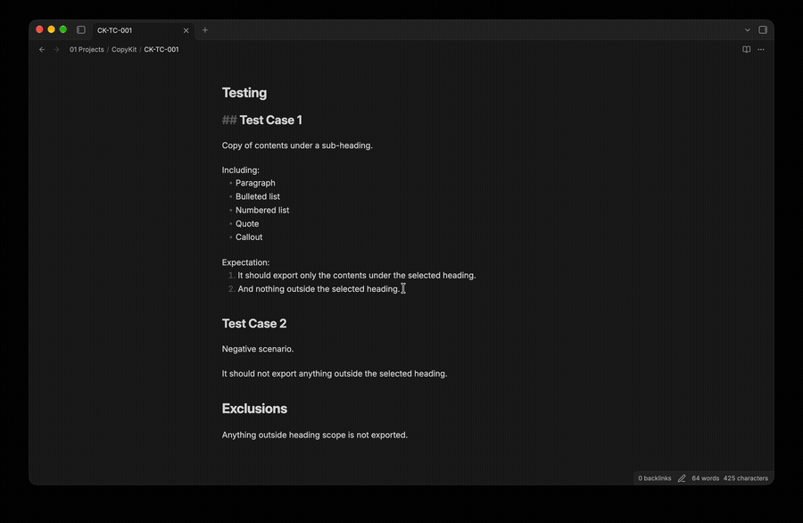
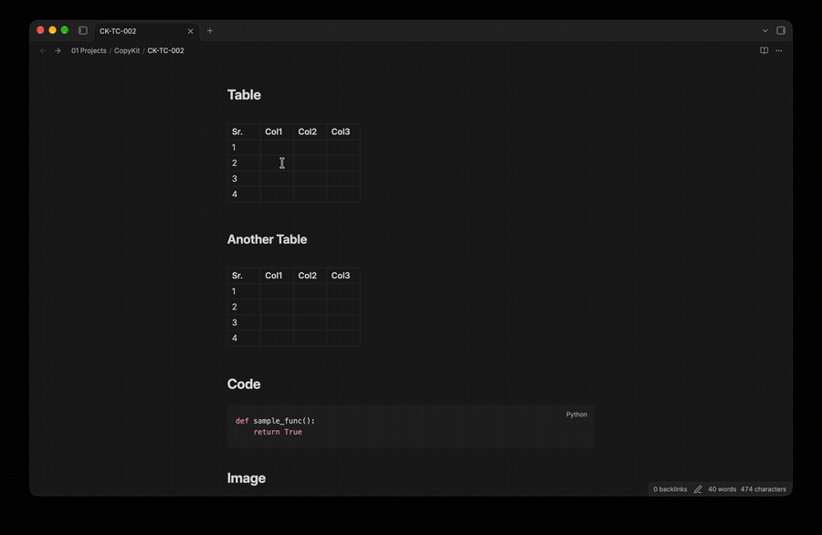
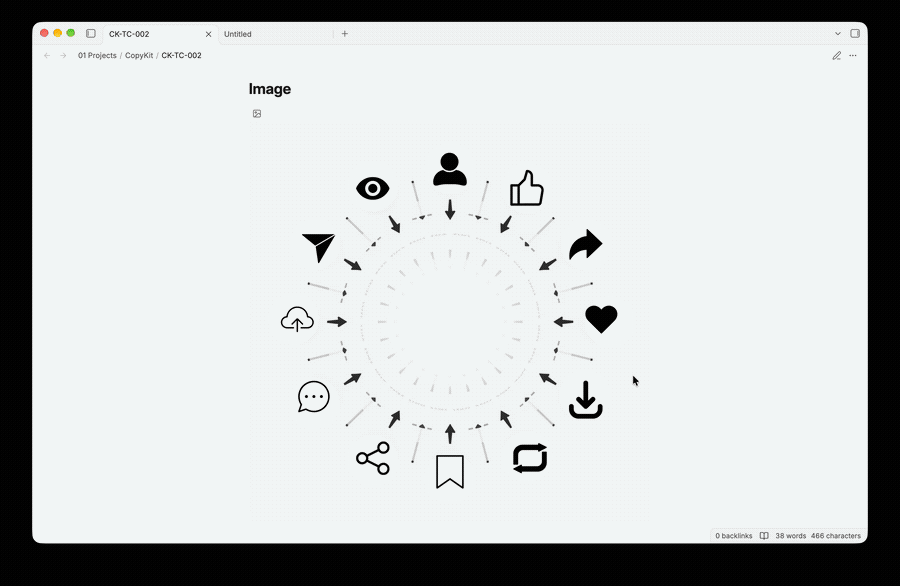

# CopyKit

> CopyKit - Copy and Export Toolkit for Obsidian

**A plugin for all your copying and exporting needs. Allows copy/export of selected texts, headings, tables, images, and more.**

## Demo

Export Selection



Export Heading


Export Table



Copy Image to Clipboard



## Features and Scope

### Unified Workflow

The command palette exposes a single **CopyKit** command. The same modal is opened from the editor context menu and the experimental Outline action.

Choose a content source:

- **Selected text** — the current editor selection.
- **Choose a heading** — choose a heading level, then a heading from the active note. The selected section includes nested headings and ends before the next heading of equal or higher level.

Choose an action and format:

| Action | Formats | Result |
| --- | --- | --- |
| Copy | Markdown | Markdown source on the clipboard |
| Copy | Plain text | Markdown syntax stripped for ordinary text |
| Copy | Formatted text | HTML clipboard data with a plain-text fallback; supported apps such as Word can paste formatted content |
| Export | PDF | PDF file generated from rendered HTML |
| Export | Markdown | `.md` file |
| Export | Plain text | `.txt` file |
| Export | Formatted text | `.html` file |

PDF and HTML conversion use `marked`, DOMPurify, `html2canvas`, and `pdf-lib`. Exported HTML is sanitized before it is copied or rendered for PDF generation. PDF pages are rendered as images, so text in PDF files is not selectable. Remote images may not appear in PDF output because cross-origin image access is restricted. PDF generation does not use runtime script injection.

### Tables and images

- Rendered tables have a **Copy / Export** action button with Markdown, HTML, CSV, and TSV copy options.
- The plugin no longer intercepts the document-wide right-click event or creates a replacement context menu. Obsidian's native context menu remains available.
- Obsidian does not currently expose a stable public API for appending plugin actions to the rendered-preview table context menu. The table action button is used instead. In the editor context menu, the plugin adds one **CopyKit…** item.

### Experimental Outline integration

The optional Outline integration is disabled by default. When enabled, it adds a small action button to Outline rows; clicking it opens the same Copy and export modal with that heading preselected when the Outline DOM exposes a usable line number. If a line number is unavailable, the integration resolves the heading by its displayed text.

This uses Obsidian's internal Outline DOM because there is no supported public API for extending its native context menu. It may need maintenance after Obsidian updates and can be removed independently by deleting `src/experimental/outline-integration.ts` and its registration in `src/main.ts`.

_Do not treat the Outline experiment as supported functionality. Verify it before use._

## Requirements

- Node.js 20 or newer (LTS recommended)
- npm
- Git
- Obsidian desktop for local plugin testing
- A separate, disposable Obsidian vault for development

## Setup

```bash
npm install
npm run typecheck
npm run dev
```

The development build writes `main.js` into the project root. The runtime files are `main.js`, `manifest.json`, and `styles.css`. The source project itself is not directly loadable by Obsidian.

## Test in a development vault

1. Create a separate empty Obsidian vault. Do not use your main vault.
2. Create `.obsidian/plugins/copykit/` in that vault.
3. Copy `manifest.json`, generated `main.js`, and `styles.css` into that directory.
4. Enable Community plugins and **CopyKit** in Obsidian.
5. Keep `npm run dev` running while editing; reload the plugin to test rebuilt output.
6. Inspect the Developer Tools console for errors.

### Development checklist

- [ ] Confirm clipboard behavior on macOS, Windows, and Linux.
- [ ] Verify heading extraction with duplicate headings, nested headings, setext headings, and frontmatter.
- [ ] Verify table conversion with escaped pipes, inline code, links, and empty cells.
- [ ] Test on mobile separately before claiming mobile support.
- [ ] Decide whether Outline integration is worth maintaining.
- [ ] Review current Obsidian API declarations before upgrading the `obsidian` dependency.

## Build commands

| Command | Purpose |
| --- | --- |
| `npm run dev` | Watch and rebuild during development |
| `npm run build` | Type-check and create a minified bundle |
| `npm run typecheck` | Run strict TypeScript checks |
| `npm run lint` | Run ESLint |
| `npm run format` | Format project files |
| `npm run format:check` | Verify formatting |
| `npm test` | Run unit tests |

## Installation

### From Obsidian

1. Open Obsidian → Settings → Community Plugins.
2. Browse/Search for “CopyKit”.
3. Install and enable.

### Manual Installation (GitHub Releases)

1. Download the latest release assets.
2. Create a folder in the vault:
    - Vault/.obsidian/plugins/copykit
3. Copy the files into that folder.
4. Reload Obsidian and enable CopyKit in Community Plugins.

## Getting Started

1. Open Settings → Community Plugins → CopyKit.
2. Open the desired note.
3. Open the context menu for the item that you want to copy/export.
4. Use the plugin options for copying or exporting.

## Git workflow

Recommended branch names:

- `feature/selection-export`
- `feature/heading-export`
- `feature/table-actions`
- `feature/image-actions`
- `experiment/outline-integration`
- `fix/<short-description>`

Use conventional commit prefixes: `feat`, `fix`, `refactor`, `test`, `docs`, `build`, and `chore`.

## Security and known limitations

- No telemetry or third-party network calls are included by plugin code.
- HTML conversion sanitizes generated HTML before clipboard use and PDF rendering.
- Clipboard writes require a supported clipboard API and a user gesture.
- Table conversion preserves displayed cell text, not necessarily every original Markdown formatting detail.
- PDF rendering is asynchronous and may differ slightly from Word or Obsidian's native rendering. Test large notes, tables, and images in your target Obsidian version.
- The Outline adapter relies on private DOM structure and is experimental.
- The project has not been verified against a live Obsidian vault in this build environment. Run the checks below and perform the manual tests before relying on it.

## Pre-release validation

```bash
npm install
npm run typecheck
npm run lint
npm run format:check
npm test
npm run build
```

Then manually test selection copy/export, duplicate and nested headings, formatted paste into Word, PDF page breaks, table actions, and Outline actions in a disposable vault.

### Versioning

Update the version in `package.json` and `manifest.json` together. Use semantic versioning:

- `0.x.y` while the feature set and public behavior are evolving.
- `1.0.0` when the core feature set is stable and tested across supported Obsidian versions.

## Support

If you find issues or have feature requests, open an issue in the repository.

## License

Apache License 2.0

Licensed under the Apache License, Version 2.0 (the “License”); may not use this file except in compliance with the License.

## NOTICE

CopyKit - Copy and Export Toolkit for Obsidian
Copyright (c) 2026 MEET VEKARIA

Required attribution:
- "CopyKit" by [MEET VEKARIA](https://github.com/meet-v/).
- Please retain this NOTICE file in redistributions, and display attribution in documentation or “About/credits” screens where third‑party notices normally appear.

Additional notices:
- Portions may include third‑party components; see their respective licenses in the distribution (if any).
- The contents of this NOTICE file are for informational purposes only and do not modify the License.

## CREDITS

Created with ❤️ [**Meet Vekaria**](https://github.com/meet-v/).

If you found this useful, I invite you to:

Buy Me a Coffee:
"https://buymeacoffee.com/meet.v",

Be a GitHub Sponsor:
"https://github.com/sponsors/meet-v"
